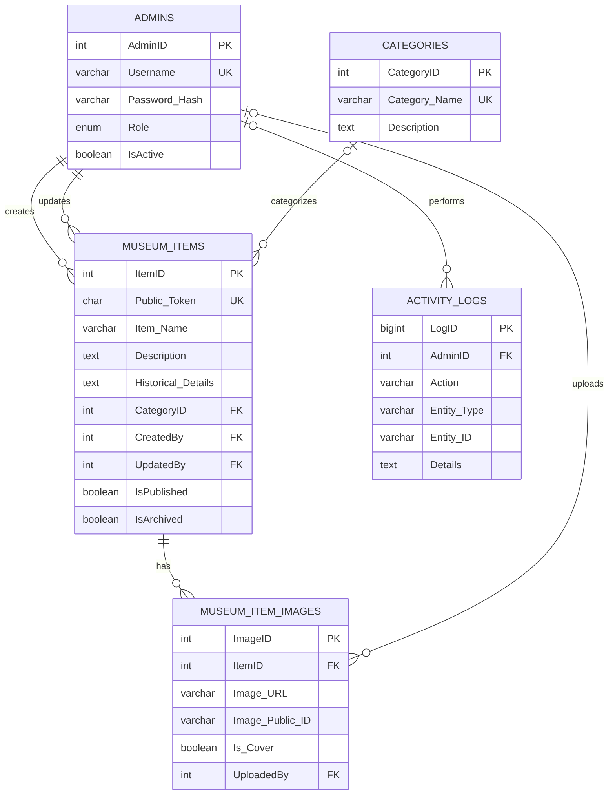

# School Museum Database Design

## Overview

- **Database:** `school_museum`
- **Engine:** MySQL 8+ or compatible MariaDB
- **Character set:** `utf8mb4`
- **SQL setup file:** `school_museum_schema.sql`

Run the SQL file in MySQL Workbench or phpMyAdmin to create the database, tables, and starter categories.

## Entity relationship diagram



## Tables and purpose

| Table | Purpose |
|---|---|
| `admins` | Staff accounts, password hashes, roles, and active status |
| `categories` | Categories for collection browsing and filtering |
| `museum_items` | Item metadata and stable public UUID token |
| `museum_item_images` | One or more Cloudinary image references per item |
| `activity_logs` | Optional record of important staff actions |

## Key design decisions

- **Images:** Store image files in Cloudinary or compatible object storage. MySQL stores each image's secure URL and provider public ID, not the image bytes.
- **Multiple images:** `museum_item_images` supports a cover image and additional photos per museum item.
- **Stable QR codes:** Flask generates a UUID in `Public_Token` when an item is created. The QR code points to the public URL containing that token. Do not change the token when editing an item.
- **Draft privacy:** `IsPublished` defaults to false. Public queries must require `IsPublished = TRUE` and `IsArchived = FALSE`.
- **Archiving:** Prefer archiving records when they should no longer appear publicly but need to be retained.
- **Passwords:** `Password_Hash` must contain a secure hash, never a plain-text password.
- **Authorization:** Flask must enforce role checks on every protected route.
- **Audit trail:** `activity_logs` can record who created, edited, published, archived, or deleted records.

## Public query rule

Every public list and detail page must exclude unpublished and archived items. For example:

```sql
SELECT ItemID, Public_Token, Item_Name, Description,
       Historical_Details, CategoryID
FROM museum_items
WHERE IsPublished = TRUE
  AND IsArchived = FALSE;
```

For an individual public item, add a parameterized condition on `Public_Token`. Do not reveal draft items just because a visitor knows their URL.

## Setup instructions

1. Back up any existing database with the same name before making changes.
2. Open `school_museum_schema.sql` in MySQL Workbench or phpMyAdmin.
3. Execute the SQL script.
4. Verify that the five tables exist and the four starter categories were inserted.
5. Configure Flask's database connection using environment variables.
6. Create the first administrator through a secure Python setup command that hashes the password. This SQL file deliberately does not create an admin with a known password.

## Instructions for OpenCode

Use this schema as the source of truth for database table and column names. If application code requires a schema change, explain it and update the schema or create a migration. Do not re-run schema creation against an existing production database without reviewing the impact first.
